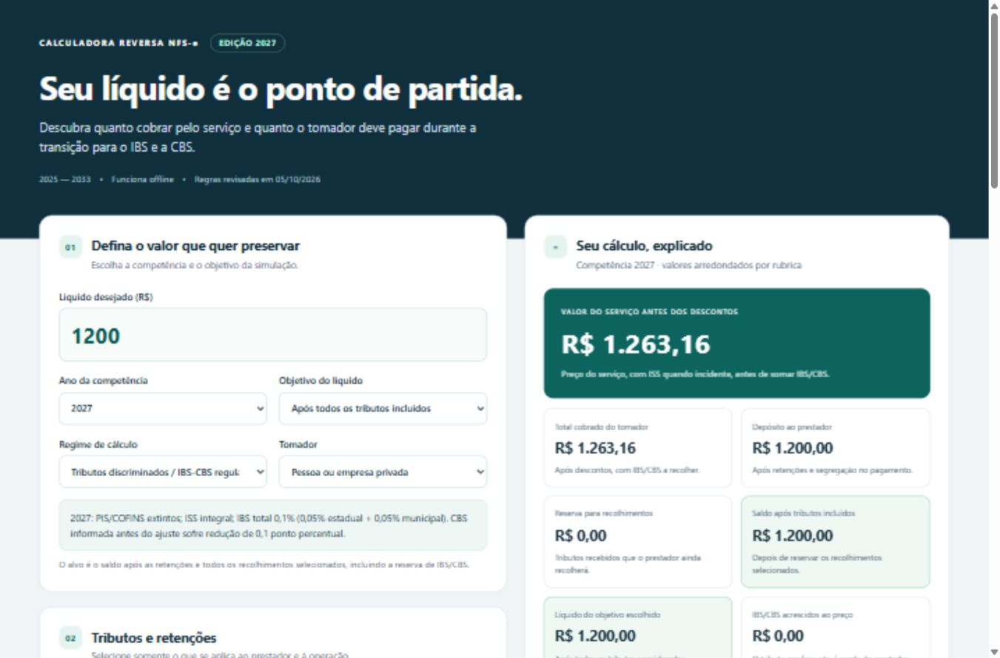

# Calculadora Reversa NFS-e — IBS/CBS 2027

Informe o líquido que o prestador precisa preservar. A calculadora encontra o preço do serviço e separa o total cobrado, o depósito, as retenções e a reserva para recolhimentos. Aplicação estática em português, sem bibliotecas externas, coleta de dados ou necessidade de conexão.



## Usar

Baixe e abra **[calc.html](calc.html)** no navegador. O arquivo inclui todos os estilos e scripts e funciona sozinho, mesmo sem o restante do repositório. `index.html` contém o mesmo aplicativo para hospedagem estática. Não é necessário instalar Node para utilizar a calculadora.

1. Escolha o ano e informe o líquido desejado.
2. Escolha o objetivo: saldo após todos os tributos incluídos ou pagamento após retenções e reserva de IBS/CBS.
3. Configure a incidência, a alíquota e o percentual da base de cada tributo. Os valores iniciais de ISS e retenções não determinam enquadramento.
4. Para IBS/CBS regular, informe a CBS aplicável antes do ajuste da transição, ou marque **alíquotas finais** para fornecer valores já ajustados.
5. Calcule. Confira a memória, copie ou imprima para PDF pelo navegador.

O resultado é invalidado sempre que um parâmetro muda. Não há armazenamento persistente de dados. As verificações realizadas e seus limites estão em [docs/VALIDACAO.md](docs/VALIDACAO.md).

## Regras consideradas

Revisão: **05/10/2026**. Fontes e limitações detalhadas em [docs/REGRAS-2027.md](docs/REGRAS-2027.md).

- 2027–2028: PIS/COFINS desativados, ISS integral, IBS total de 0,1% e ajuste da CBS de menos 0,1 ponto percentual. A CBS de referência não é preenchida com uma estimativa. O campo vazio bloqueia o cálculo enquanto IBS/CBS estiverem ativos.
- O ISS incidente é excluído da base IBS/CBS até 2032. Para 2026, o usuário informa separadamente PIS/COFINS incidentes a excluir; retenção não é automaticamente tratada como incidência da apuração.
- IBS/CBS são acrescidos por fora. Se o prestador receber os tributos, o resultado mostra uma reserva; se houver segregação, mostra a saída no pagamento. O saldo após tributos permanece igual nos dois cenários.
- 2026: destaque de IBS/CBS pode ser apenas informativo, conforme a dispensa de recolhimento por cumprimento de obrigações acessórias. Compensações de valores efetivamente recolhidos não são apuradas aqui.
- 2029–2032: ISS a 90%, 80%, 70% e 60% da alíquota municipal. Em 2033, desativado. IBS/CBS dos anos seguintes exigem alíquotas daquele ano, sem inferir a alíquota final da transição.
- IR: retenção configurável por alíquota ou tabela mensal IRPF de 2026 com redução mensal, deduções e pagamentos anteriores da mesma fonte. Exige confirmação dos parâmetros para a competência; não presume uma tabela nova para 2027.
- INSS: pessoa física usa **base mensal restante** informada, limitada pelo teto. PJ com retenção não usa teto. O teto de 2026 é oferecido somente nessa competência e deve ser reduzido pelas bases já utilizadas. Não se transporta o teto automaticamente para 2027.
- Compras públicas: alíquotas finais e confirmação obrigatórias quando IBS/CBS ativos. O motor não presume a redistribuição dos tributos nem o redutor da operação.
- Simples/MEI: composição manual da carga informada, sem simular anexos, fator R ou receita acumulada. IBS/CBS regular fora do DAS deve ser configurado no modo regular. Evite dupla contagem de tributos já incluídos no DAS.

**O saldo é líquido dos itens selecionados, não lucro nem apuração fiscal completa.** Créditos, IRPJ, apuração mensal de CSLL, custos, regimes específicos, dispensa por limites de retenção e obrigações acessórias não são determinados automaticamente.

## Exemplo de conferência

Líquido de R$ 1.200,00, ISS retido a 5%, sem outros tributos: serviço de **R$ 1.263,16** e ISS de **R$ 63,16**.

Para testar a mecânica de IBS/CBS, suponha uma CBS **hipotética** antes do ajuste de 10%, sem redução setorial: base IBS/CBS de R$ 1.200,00; IBS de R$ 1,20; CBS de R$ 118,80; total cobrado de R$ 1.383,16. Se o prestador receber os novos tributos, depósito de R$ 1.320,00 e reserva de R$ 120,00, preservando o saldo de R$ 1.200,00. **10% é apenas um exemplo matemático; não é uma alíquota oficial.**

## Desenvolver e verificar

Node 20 ou superior, sem dependências npm:

```sh
npm run build
npm run check
```

- `src/engine.js`: cálculo, calendário, validação e inversão.
- `src/app.js`: interface e memória.
- `src/page.html` e `src/styles.css`: apresentação.
- `scripts/build.cjs`: gera `calc.html` e `index.html` com tudo incorporado.
- `tests/engine.test.cjs`: regressões de cálculo e reconciliação em centavos.
- `.github/workflows/check.yml`: verificação automática em push e pull request.

Edite as fontes e execute o build; a verificação falha se os HTMLs não corresponderem às fontes. A versão anterior permanece recuperável pelo histórico Git.

## Precisão e limites

Tributos e descontos são arredondados por rubrica a duas casas decimais. O motor inverte o cálculo sem arredondamento e busca um preço em centavos ao redor da solução. Prioriza um líquido exato; se houver excedente, informa-o. Bloqueia dados ausentes, percentuais negativos e margem sem crescimento seguro. Em condições extremas de margem, pode exigir revisão manual em vez de devolver um preço impraticável. Limite de alvo: R$ 100 milhões; preço: R$ 1 bilhão.

Distribuição sob a licença existente do repositório.
